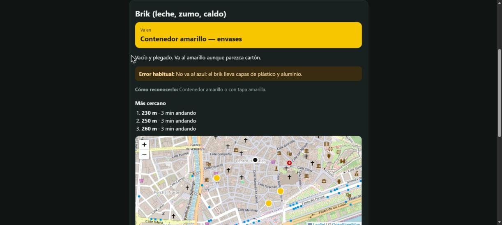

# TiraBien ♻️ — which bin does it go in?

Point your phone at any item (or type its name) and TiraBien tells you **which bin it goes in in Málaga**, why people usually get it wrong, and **where the nearest real container is**, with walking time and a map. In Spanish and English.

- **AI runs on your device.** A SigLIP vision model (ONNX, ~100 MB, cached after the first use) runs in a web worker. Photos are never uploaded; there is no account and no backend.
- **The AI never decides the bin.** It only recognises *which catalog item* the photo looks like. The bin comes from 73 hand-written rules based on public Limasam, Ecoembes and Ecovidrio guidance (not audited by Limasam; see Limits). When the model is unsure it says so and asks you to pick.
- **Real data.** 14,400 container locations: Ayuntamiento de Málaga open data (glass, clothes, oil, batteries; CC BY 4.0) and OpenStreetMap (yellow, blue, grey, brown bins, clean points, pharmacies; ODbL). Nearest-container search uses a grid index verified against brute force.

**Live demo: https://tapaderuza.github.io/tirabien/**



## Why

In Spain roughly three in ten items in the yellow bin are not packaging at all (Ecoembes' own characterisation figures, 28.6 % in 2020). The mistakes are systematic and predictable: drink cartons put in the blue bin, thermal receipts and dirty napkins treated as paper, drinking glasses in the glass igloo, toys and toothbrushes in the yellow bin because they are plastic. TiraBien answers exactly those cases, with the reason.

## How good is the vision?

Measured on 272 real Wikimedia Commons photos of 37 items (search results, not hand-picked; 22 photos that plainly did not show the item were removed and are listed with reasons in [`eval/excluded.json`](eval/excluded.json)). Full report: [`eval/RESULTS.md`](eval/RESULTS.md).

| | |
| --- | --- |
| Correct bin when the app answers *confidently* | **96.8 %** (150/155, 57 % of photos) |
| Correct bin if forced to answer every photo | 79.4 % |
| Exact item in the top 3 | 84.6 % |
| Speed in the browser (WASM, CPU) | about 2 s per photo |

The confidence threshold was picked from the sweep in that report using the same photos, so read 96.8 % as optimistic. Below the threshold the app shows its top candidates and asks instead of guessing. Not evaluated: photos taken on a phone in a kitchen, and items outside the 73 in the catalog.

## Run it

```bash
npm install
npm test          # 75 unit tests
npm run dev       # http://localhost:5173
npm run build     # static site in dist/
```

Everything the app needs at runtime is already in `public/data/`. To rebuild the data:

```bash
npm run data:containers   # container locations (Málaga open data + OpenStreetMap)
npm run data:embeddings   # SigLIP text embeddings for the catalog (downloads ~330 MB once)
node scripts/fetch-eval-images.mjs && npm run eval   # re-measure accuracy
```

## Layout

| Path | What |
| --- | --- |
| `src/catalog.ts` | The rules: 73 items → bin, tip, common mistake, alternatives, visual prompts |
| `src/streams.ts`, `src/sources.ts` | The ten disposal routes and the official sources they cite |
| `src/search.ts` | Accent-insensitive Spanish/English search with typo tolerance |
| `src/classify.ts` | SigLIP scoring and the confident / likely / unsure / not-waste decision |
| `src/geo.ts`, `src/answer.ts` | Grid nearest-neighbour index, walking time, answer builder |
| `src/vision.worker.ts` | In-browser model (transformers.js, ONNX, WASM) |
| `scripts/` | Data and evaluation pipeline |

## Limits, stated plainly

- Objects outside the 73-item catalog are not recognised as "unknown": a camera lens photo, for example, came back as a confident "CD/DVD". The "not waste" labels only cover people, animals, scenes, screens, stages, nature and abstract images. Extending the catalog and adding an "unknown object" label is the next improvement.
- Málaga only. Rules and data are the city's; other municipalities differ.
- The rules are a careful reading of public guidance, not an official source. A few Málaga-specific details (for example which bulky items Limasam collects free) should be confirmed with Limasam before relying on them. Each answer links the sources it follows; corrections are welcome as issues.
- OpenStreetMap lists only 27 brown (organic) bins in the city, so the map for food waste is sparse; the app says when a stream has little or no data.
- Coffee capsules are flagged as *changing*: EU law has counted them as packaging since 12 Aug 2026, but Spain has not updated its rules yet.
- The first photo downloads ~100 MB of model weights; after that it works offline for the model (the map tiles still need a connection).

## AI assistance

This project was designed and written with an AI coding assistant (Claude Code), which also chose the concept from options researched for the author. The author reviews it and is responsible for what is published. Disposal rules were written from public guidance, not from Limasam's internal data.

## Licence

MIT. Data: see the credits above (CC BY 4.0 and ODbL).
